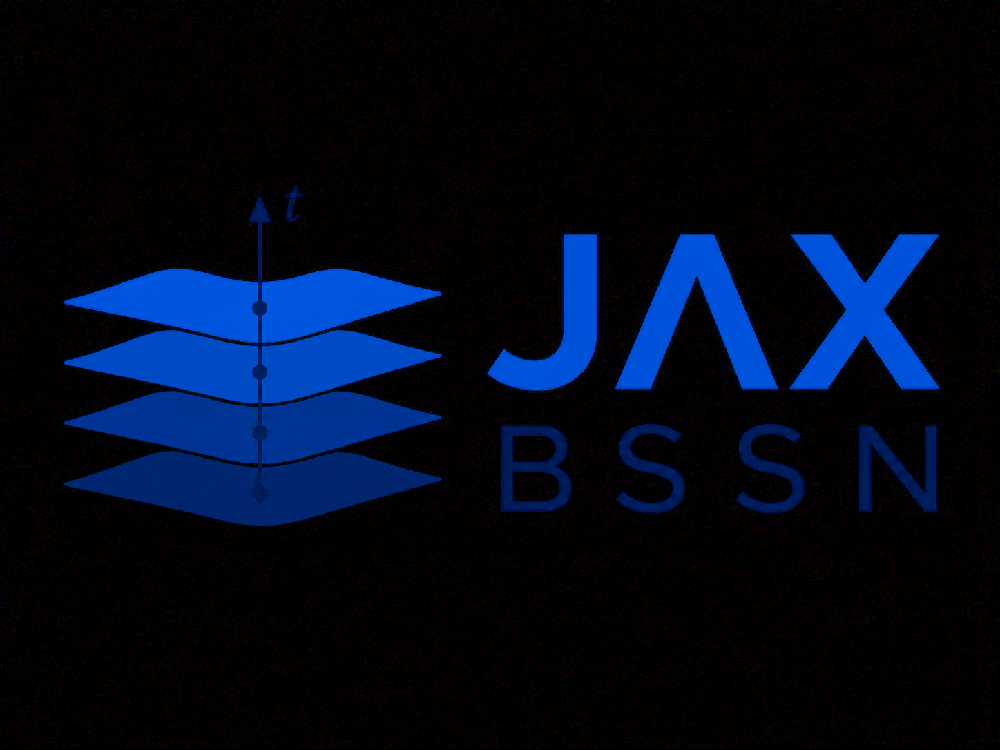

# JAX BSSN

<p align="center">
  
</p>

JAX-BSSN is an autodifferentiable implementation of the BSSN evolution system
for numerical relativity. JAX-BSSN features Kreiss–Oliger dissipation, momentum
constraint damping, and fixed mesh refinement.

## Installation

From the repository root:

```bash
python -m venv .venv
source .venv/bin/activate
python -m pip install --upgrade pip
python -m pip install -e ".[demos,test]"
```

Install a JAX build appropriate for the intended CPU or accelerator when the
default dependency does not match the target hardware.

## Supported demos

The supported physical examples are:

1. Gauge wave
2. Linear wave
3. Spherical Cartoon puncture
4. Axisymmetric black hole head-on collision

Each demo owns its initial data and run configuration. There is no generic
simulation CLI or installed initial-data dispatcher.

Run the periodic analytic gauge wave:

```bash
python demos/gravitational_waves/gauge_wave.py
```

Run the linear wave through a nested fixed-refinement hierarchy and write composite
openPMD output:

```bash
python demos/gravitational_waves/linear_wave.py
```

Run the compact spherical Cartoon puncture and write its complete reflected
axis to openPMD:

```bash
python demos/spherically_symmetric_cartoon_puncture/cartoon_puncture.py
```

Run the axisymmetric Cartoon head-on collision of two black holes:

```bash
python demos/axisymmetric_blackhole_collision/axisymmetric_blackhole_collision.py
```


The default production runs compile substantial JAX kernels. The
[demo guide](docs/demos.rst) describes the evolution and configuration options.

## Package structure

```text
JAX_BSSN/
├── bssn/          # state, tensor algebra, geometry, equations, raw constraints
├── cartoon/       # spherical and axisymmetric reconstruction/evolution
├── EM/            # Cartesian first-order Maxwell evolution and BSSN coupling
├── evolution/     # derivatives, boundaries, RHS assembly, projections, RK4
├── fmr/           # nested-patch geometry, transfers, stage-synchronous RK4
├── diagnostics/   # reductions, reporting, plotting, openPMD
└── utilities/     # reusable initial-data and numerical helper routines
```

Demos own their physical initial data and configuration; reusable Bowen–York
helpers live in `JAX_BSSN.utilities`. Analytic reference data lives under
`tests/`, while integration tests also exercise demo runners.

## Tests

Install test dependencies and run the complete suite with:

```bash
python -m pip install -e ".[test]"
python -m pytest
```

Tests use double precision and write no simulation output except dedicated
openPMD round-trip tests in temporary directories.
